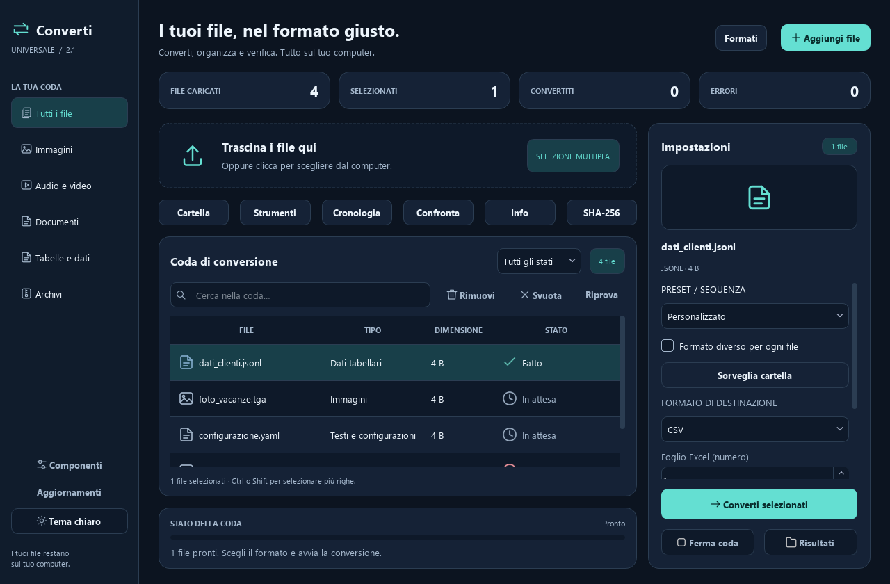

# Convertitore Universale

Applicazione Windows in italiano per convertire immagini, audio/video, documenti,
PDF, tabelle, archivi e sottotitoli. Elaborazione locale, con OCR opzionale.

## Revisione estesa — 1 novembre 2026

La revisione dei sorgenti basata sulla 2.1.2 è disponibile in questo repository.
**72 test superati, senza errori o test saltati**, comprese conversioni reali
multimediali, OCR, Office e presentazioni.

- Nuova interfaccia chiara/scura, catalogo dei formati e filtri della coda.
- JSONL/NDJSON, immagini TGA/PPM/PGM/PBM/PCX, uscita audio Opus/AIFF.
- Esportazione come testo di YAML, TOML, INI, CFG e XML; lettura UTF-16/32 e Windows-1252.
- Python e modulo C++ per SHA-256, con confronto dell'impronta attesa e ripiego Python.
- Correzioni per CSV Windows, rilevamento FFmpeg, PDF ricercabili OCR,
  anteprime ripetute, annullamento e protezione degli originali.

## Scaricare e provare la revisione

1. Scarica [lo ZIP aggiornato](Convertitore_Universale_revisione_estesa.zip).
2. Estrai tutto ed entra nella cartella `Convertitore_Universale`.
3. Apri **Setup.vbs**, scegli i componenti necessari e completa la preparazione.
4. Apri **Avvia.vbs**.

Il setup dei sorgenti richiede Internet e Python 3.11–3.13; può proporre Python
3.12 tramite WinGet. Audio/video usano FFmpeg, Office usa LibreOffice e OCR usa
Tesseract. I componenti esterni possono richiedere una conferma UAC.

[SHA-256 dello ZIP](revisione-estesa-SHA256.txt) ·
[Novità e dettagli](docs/REVISIONE_FORMATI_INTERFACCIA.md) ·
[Resoconto dei 72 test](docs/VERIFICA_REVISIONE.txt) ·
[Interfaccia chiara](docs/anteprime/nuova-interfaccia-light.png) ·
[Catalogo formati](docs/anteprime/catalogo-formati.png)

## Installer e aggiornamenti

L'[installer di anteprima 2.1.2](https://github.com/Giordano13/convertitore-universale/releases/tag/v2.1.2)
resta disponibile, ma **non contiene questa nuova revisione**. Non è stato
pubblicato un nuovo EXE né modificato il manifest `release/update.json`.
Il precedente [Convertitore_GitHub.zip](Convertitore_GitHub.zip) è conservato
come archivio della versione precedente; per le novità usa lo ZIP aggiornato.

## Sviluppo e build

I sorgenti sono ora disponibili direttamente in `app/`, `native/`, `tools/`
e `tests/`. Il workflow **Crea setup Windows (bozza)** usa questi sorgenti,
compila il modulo C++ e verifica i test previsti dalla pipeline.

Per compilare localmente servono Visual Studio Build Tools con C++ x64 e
Inno Setup 6.3 o successivo. Dopo il setup dei sorgenti, esegui **CreaSetup.bat**.
La build dell'installer è predisposta ma non è stata eseguita per questa revisione.
Prima di pubblicare un nuovo installer occorre assegnare una nuova versione,
verificarlo su Windows e aggiornare il manifest solo dopo il caricamento dell'EXE.

Le dipendenze per tutti i test sono in `requirements-test.txt`.
Consulta il [manuale delle conversioni](docs/MANUALE_CONVERSIONI.md) e
le [istruzioni di pubblicazione](docs/PUBBLICAZIONE.md).

## Licenza e sostegno

Codice distribuito con licenza **GNU AGPLv3**: [LICENSE](LICENSE).
Le dipendenze conservano le rispettive licenze. Le donazioni sono volontarie;
la pagina donazioni non è ancora configurata. Il pulsante di sostegno è nelle
impostazioni avanzate e non raccoglie dati di pagamento.
